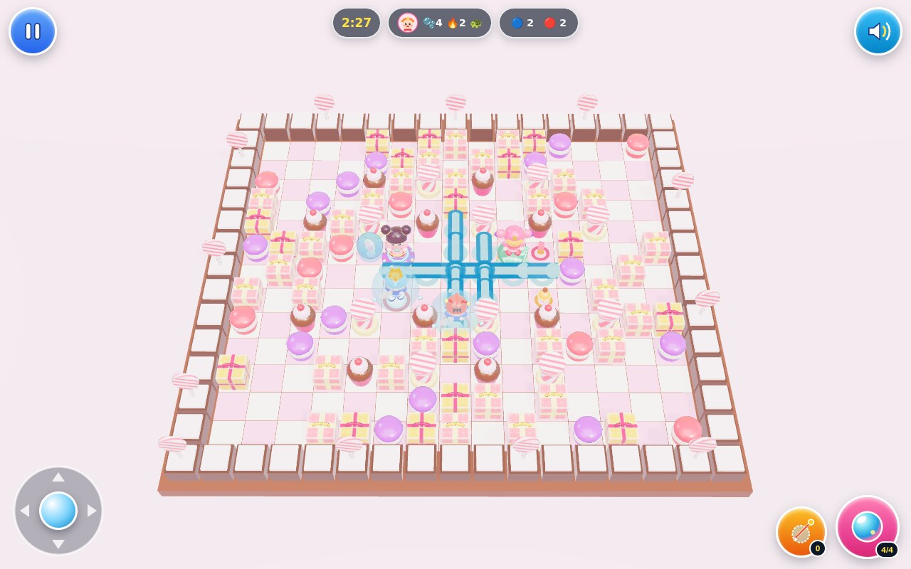

# QQ Tang: Candy Bubble Arena 3D (QQ堂 3D)

**Play Live:** [QQ Tang: Candy Bubble Arena 3D on GitHub Pages](https://kunruiw1991.github.io/qq-tang-3d/)  
**Repository:** [github.com/kunruiw1991/qq-tang-3d](https://github.com/kunruiw1991/qq-tang-3d)



A vibrant, zero-build 3D web remake of Tencent's classic casual arcade game **QQ Tang (QQ堂)** built with pure ES2022 modules, procedural **Three.js WebGL2** PBR dioramas, deterministic `60 Hz` fixed-timestep physics, smart autonomous AI allies & rivals, procedural **WebAudio** music & arcade sound effects, and an icon-first interface playable effortlessly by both a 5-year-old on iPad touch and nostalgic desktop keyboard players.

---

## Core QQ Tang Mechanics

- **Free-Stride Grid Movement & Corner-Assist**: Smooth `60 Hz` movement across a `15 × 13` 3D arena grid (`radius = 0.36`) with automatic lane-centering and corner-slide assistance around blocking pillars.
- **Glossy 3D Sugar Bubbles & Walk-Off Solidification**: Newly placed sugar bubbles grant walk-off grace passability to any character overlapping at placement, then permanently solidify once stepped off (`3.0s` fuse with squash-and-stretch 3D candy wobble).
- **4-Way Cardinal Syrup Blasts & Instant Chain Reactions**: Bubbles detonate into 4-directional water/syrup jets (`0.40s` linger) clamped before indestructible `HARD_WALL` tiles, halting at (and shattering) the first destructible `SOFT_BLOCK` per ray, and triggering synchronous same-tick BFS chain detonations across touching bubbles.
- **Giant Water-Bubble Trap, Pop, Ally Rescue & Needle**:
  - **Bubble-Trap**: Unshielded, unmounted characters hit by a blast are encased inside a wobbling giant 3D water bubble (`5.5s` timer, `0.22×` drift speed) rather than eliminated immediately.
  - **Teammate Instant Rescue**: Touching a trapped teammate pops them free instantly (`1.5s` rescue invulnerability; wins same-tick ties over enemy contact).
  - **Enemy Contact Pop**: Opposing players touching a trapped rival burst the bubble for an instant elimination (`+1 KO`).
  - **Needle Self-Rescue**: Activating a collected **Rescue Needle (救命针)** while trapped bursts the water bubble from the inside and restores normal play.

### Classic Power-Ups & Rideable Mounts

Soft blocks drop 8 authentic *QQ Tang* items & rideable mounts (`0.55s` spawn blast-grace so revealing blasts never destroy newly dropped loot):

| Item / Mount | Name | Gameplay Effect |
| :--- | :--- | :--- |
| **Sugar Bubble** | 糖泡 (`bubble`) | `+1` max simultaneous bubbles (up to character cap `6–8`) |
| **Power Syrup** | 威力糖浆 (`power`) | `+1` cardinal blast tile range (up to character cap `6–8`) |
| **Roller Skates** | 溜冰鞋 (`speed`) | `+0.45 tiles/s` movement speed (up to character cap `7.2–8.0`) |
| **Kick Boot** | 踢泡靴 (`kick`) | Walk into stationary solidified bubbles to slide them down open lanes at `10.0 tiles/s` |
| **Rescue Needle** | 救命针 (`needle`) | Active item (`cap 3`) that instantly self-rescues from the trapped water-bubble state |
| **Candy Shield** | 护盾 (`shield`) | Golden barrier absorbing `1` blast hit (`1.1s` invulnerability) before mount or player |
| **Turtle Mount** | 乌龟 (`turtle`) | Rideable 3D turtle (`3.6 tiles/s` steady pace, `6.2 tiles/s` boosted at `3+` skates); sacrifices mount to absorb `1` blast hit while keeping the rider safe & untrapped |
| **UFO Mount** | 飞碟 (`ufo`) | Rideable 3D saucer (`6.6 tiles/s` hover glide, ignores bun-carry slowdown, glides freely over `SOFT_BLOCK` tiles); sacrifices mount to absorb `1` blast hit while keeping the rider safe & untrapped |

---

## Classic Playable Cast, Arenas & Modes

### 4 Playable Chibi 3D Characters

| Character | Trait | Start / Cap Bubbles | Start / Cap Power | Start / Cap Speed (`tiles/s`) |
| :--- | :--- | :---: | :---: | :---: |
| **MiDuo (米多)** | Balanced All-Rounder (全能甜心) | `1 / 7` | `2 / 7` | `5.0 / 7.5` |
| **XiaoQiang (小强)** | Multi-Bubble Trapper (连泡达人) | `2 / 8` | `1 / 6` | `4.8 / 7.2` |
| **HaiWangZi (海王子)** | Long-Range Blaster (深海威力) | `1 / 6` | `2 / 8` | `5.2 / 7.6` |
| **WanZi (丸子)** | Speed Sprinter (疾风冲刺) | `1 / 6` | `1 / 6` | `5.5 / 8.0` |

### 4 Iconic Themed 3D Arenas

1. **Candy Town (糖果镇)**: Pastel frosting checkerboard, frosted cupcakes, ribbon gift boxes, macarons, and striped lollipop borders with bouncy bubblegum marimba BGM.
2. **Pirate Bay (海盗船)**: Timber ship deck, iron cannons, anchors, treasure chests, wooden rum barrels, and a jaunty sea-shanty BGM.
3. **Ice & Snow Village (冰雪村)**: Frosted glacier tiles, crystal ice pillars, snowmen, pine trees, wrapped winter gifts, and sparkling celesta chime BGM.
4. **Toy Block Kingdom (积木城)**: Studded playroom floor, interlocking primary-color brick towers, wooden alphabet blocks, toy train props, and staccato toy-piano march BGM.

### 3 Playable Game Modes

1. **Classic 2v2 Arena (经典对战)**: Blue Team (`P1 + AI Ally`, or `P1 + P2` shared keyboard) vs Red Team (`2 AI Rivals`), featuring tactical ally rescues, rival bubble-pops, and a 3D stepped 1st–4th Victory Podium with candy confetti.
2. **Bun Mountain / Candy Grab (抢包山)**: Snatch golden steamed buns from the central shrine and carry them (`0.75×` carry speed unless riding UFO) back to your team's glowing home base. Trapped carriers drop their bun onto the nearest open tile; first team to bank `5` buns (or Sudden-Death Overtime winner) takes gold.
3. **Co-op Boss Challenge: Mechanical Golem (机械傀儡)**: 4-hero co-op battle (`3` shared team revives) against a multi-tile (`2 × 2`) articulated 3D **Mechanical Golem (`12 HP`)** across 2 phases with `1.2s` floor-telegraphed attacks (*Sky Bomb Barrage*, *Cardinal Steam Shockwave*, *Gear-Crate Drop*) and periodic boss loot drops every `3 HP`.

---

## Controls (iPad Touch & Desktop Keyboard)

Designed for zero page scrolling across desktop (`1280×800`), iPad (`1024×768`), mobile landscape (`844×390`), and mobile portrait (`390×844`), displaying **at most 5 clickable HUD controls** during gameplay (`>= 64px × 64px` touch targets):

| Input Mode | Move | Drop Sugar Bubble | Use Rescue Needle | Pause / Audio |
| :--- | :--- | :--- | :--- | :--- |
| **iPad / Mobile Touch** | Bottom-left **Virtual Joystick** | Pink **Bubble Button** (bottom-right) | Gold **Needle Button** (bottom-right) | Top-left **Pause** / Top-right **Speaker** |
| **Desktop 1P** | `WASD` or `Arrow Keys` | `Space` | `Left/Right Shift`, `E`, or `Q` | `Esc` or `P` (Pause) · `M` (Mute) |
| **Desktop 2P Co-op** | **P1:** `WASD` · **P2:** `Arrow Keys` | **P1:** `Space` · **P2:** `Enter` / `Numpad 0` | **P1:** `Left Shift`/`E`/`Q` · **P2:** `Right Shift`/`/` | `Esc` or `P` (Pause) · `M` (Mute) |

---

## Architecture & Local Quickstart

The entire game uses **100% relative ES module imports** (`./` and `../`) with self-contained vendored Three.js (`./vendor/three.module.min.js`) and **zero `<script type="importmap">`** specifiers for seamless compatibility across iPadOS Safari/WebKit, desktop Chrome/Firefox/Edge, local static servers, and GitHub Pages subpaths.

```text
qq_tang_3d/
├── index.html                  # Static entry point (zero importmaps, zero external CDN dependencies)
├── styles/main.css             # Responsive 4-viewport zero-scroll layout & >=64px touch controls
├── vendor/three.module.min.js  # Self-contained Three.js r170 ES module
├── src/
│   ├── contracts/constants.js  # Shared grid, character, item, arena, mode & timing constants
│   ├── sim/                    # Pure deterministic 60Hz simulation (physics, combat, arenas, modes)
│   ├── ai/                     # BFS danger-aware BotAI & 2-phase 2x2 Mechanical Golem BossAI
│   ├── render/                 # Procedural Three.js WebGL2 arenas, chibi rigs, bubbles, mounts & podium
│   ├── audio/synth.js          # Procedural WebAudio BGM step-sequencer & 12+ arcade SFX
│   ├── ui/                     # SVG iconography, W3C Pointer/Touch/Keyboard input & HUD screens
│   └── main.js                 # Fixed-timestep rAF loop & diagnostic stepping seam
├── tests/                      # 5-tier automated headless Chrome WebGL2 E2E verification suite
└── screenshot.jpg              # Live 1280x800 WebGL2 gameplay capture
```

### Run Locally

Serve the repository root with any static HTTP server:

```bash
python3 -m http.server 8080
```

Then open [http://localhost:8080](http://localhost:8080) in any modern desktop or mobile browser.

### Run Automated Headless WebGL2 E2E Suite

```bash
PYTHONDONTWRITEBYTECODE=1 python3 -B tests/run_e2e.py --tier all
```
